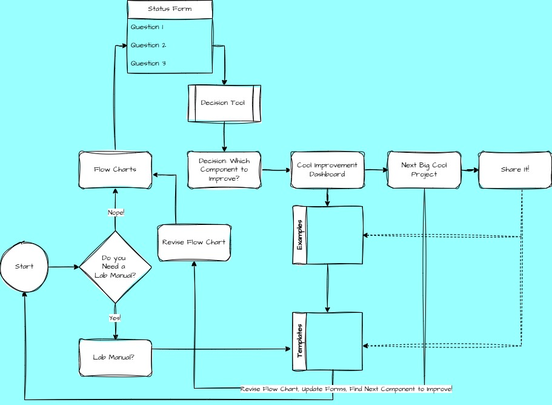

## Why a 'PAM Workflow Flowchart'?

::::: columns
::: {.column width="40%"}
For many, creating a diagram of your workflow is an intuitive approach to identifying the parts of the process, and from there we can start to think about information related to each of these workflow components (status, methods, POC, etc).
:::

::: {.column width="60%"}
{width="385"}
:::
:::::

## What do I need to Start?

You will need to work in R/Quarto (RStudio or Positron) and Github. We also recommend Github Desktop to facilitate working locally and saving to the cloud (github). If you are new, we recommend the [PSAW 2022 R/Github Training Sessions](https://rverse-tutorials.github.io/PSAW-2022/) to get started.

If you need help, join the PAM-Community Co-working Meetings.

## Then what?

1.  **Getting Started:** Create your own Workflow Repo (one per science center)

2.  **Create Individual Flowcharts:** Create a flowchart page for each individual workflow.

3.  **Flowchart Build:** Build a Flowchart using your existing documentation and/or the draw.io web application

4.  **Flowchart Refine:** Refine your flowchart (draw.io)

5.  **PAM Flowchart:** Comlete PAM-SI surveys for your PAM workflow Flowchart

6. **Share Results:** Reach out to shannon.rankin@noaa.gov to learn how to submit your results.

Follow the button on the bottom right to get started (or follow the process using the left sidebar)
