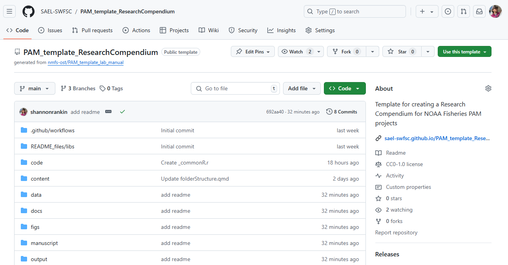
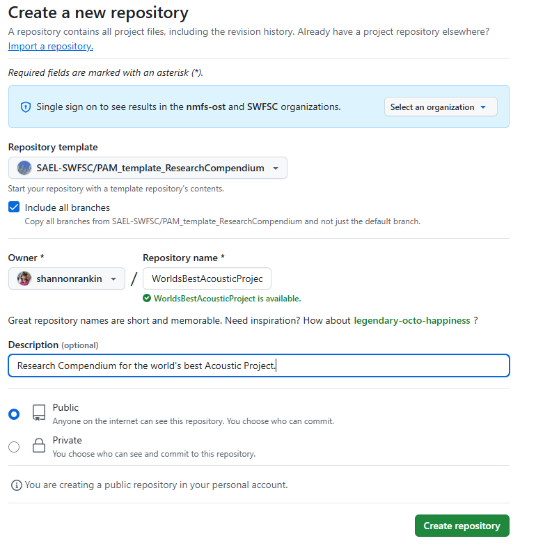
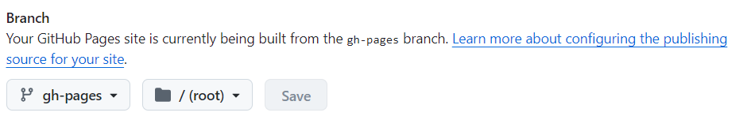
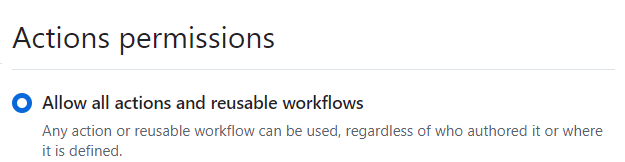
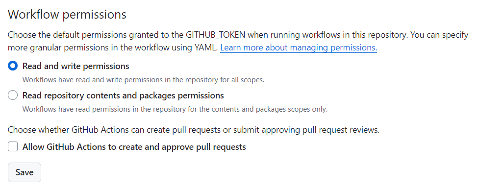
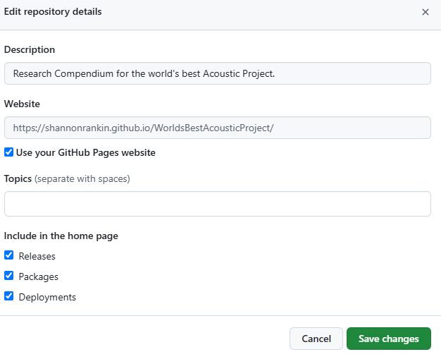
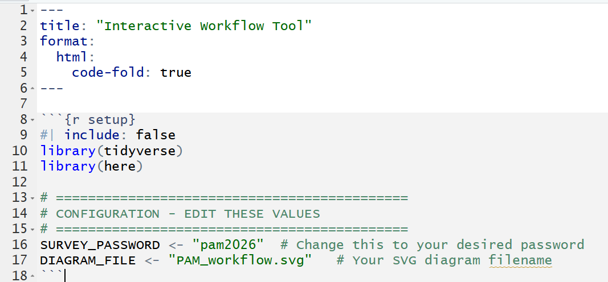

## How To Use This Template

Use this template to create a copy of this repository for your own science center. Once you create your own version, you can then get to work!

Follow the steps below to copy this template to your lab's GitHub

1.  Open \[this repository on GitHub\]

2.  Click on the 'Use this template' button in the top right, select 'Create new repository'

    

3.  Edit repository settings

    - Select the 'Include all branches' option

    - Select your lab organization or yourself as the owner and append the name with the initials of your science center (ex "\_SWFSC")

    - Make description "PAM Workflows for ***Project Name***"

    - Make the repo public

      

4.  Click create repository

5.  Turn on GitHub pages under Settings-\>Pages. You will set pages to be made from the gh-pages branch and root directory

    

6.  Update 'Actions' settings

    - Under Settings -\> Actions -\> General -\> Actions permissions select 'Allow all actions and reusable workflows'. Select save

      {width="323"}

    - Under Settings -\> Actions -\> General -\> Workflow permissions select 'Read and write permissions'

      

      ::: callout-important
      ## Note: Both of these settings may already be selected but you have to click save for both
      :::

7.  Return to the main page of the repo to edit your website

    - Click on 'Code' in the top left

    - Click on the settings button next to the 'About' section on the right side of the repository

    - Select 'Use your GitHub Pages website'. This should autopopulate the website

    - Select 'Save Changes'

      

8.  The foundation for your project is now created! We recommend that you first modify the ReadMe to add your Project Name in the appropriate places.

## Create Flowchart Pages for each Workflow

You will need a separate flowchart page for each workflow:

1.  Identify each workflow, and give it a simple name.

2.  Create a copy of the content/flowchart.qmd for each workflow, and rename it by appending with the simplename. Use snake-case

3.  Add this page name to the \_quarto.yml

4.  Are there any changes that need to be made to the csv or other to ensure things do not overwrite each other???

    1.  Change name for diagram from "PAM_workflow.svg" to the simplename of the specific workflow.

        

    2.  xx
